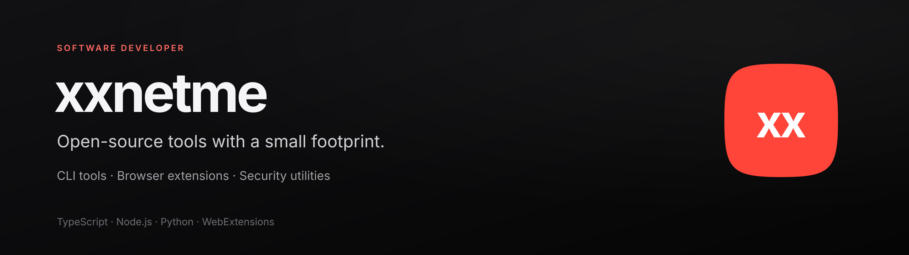

## About

I build focused developer tools and browser extensions. My work centers on TypeScript, Node.js and practical system utilities: small footprints, predictable behavior, clean workflows and documentation that reflects the actual product.

### Featured · [RuTube Tools](https://github.com/xxnetme/rutube-tools)

Download RuTube videos and playlists in MP4, extract audio to M4A, step through frames, save subtitles and resume interrupted downloads — locally in Firefox or Chromium.

[Website](https://xxnetme.github.io/rutube-tools/) · [Releases](https://github.com/xxnetme/rutube-tools/releases) · [Source code](https://github.com/xxnetme/rutube-tools)

### Developer tools

| Project | What it does |
| :--- | :--- |
| **[portx](https://github.com/xxnetme/portx)** | Inspect listening ports and terminate processes from a fast, zero-dependency CLI. |
| **[env-guard](https://github.com/xxnetme/env-guard)** | Audit `.env` files, synchronize drift and detect committed secret leaks. |
| **[unghost](https://github.com/xxnetme/unghost)** | Find and sanitize zero-width characters, steganography and Trojan Source sequences. |
| **[promptpak](https://github.com/xxnetme/promptpak)** | Package a codebase into an LLM-ready prompt with `.gitignore` filtering and a directory tree. |
| **[benchx](https://github.com/xxnetme/benchx)** | Benchmark commands with nanosecond timing and statistical comparisons. |
| **[git-tidy](https://github.com/xxnetme/git-tidy)** | Prune merged and stale branches with safety checks and repository cleanup. |

### Open-source contributions

| Project | Contribution |
| :--- | :--- |
| **[Vencord #4685](https://github.com/Vendicated/Vencord/pull/4685)** | Fixed duplicated ListenBrainz artist credits using canonical MusicBrainz credit strings. |
| **[AutoSuppressEmbeds](https://github.com/xxnetme/Vencord/tree/feat/auto-suppress-embeds/src/plugins/autoSuppressEmbeds)** | URL embed suppression with domain allowlists, blocklists and a chat-bar toggle. |
| **[NormalizeQuotes](https://github.com/xxnetme/Vencord/tree/feat/normalize-quotes/src/plugins/normalizeQuotes)** | Normalizes curly quotes and typographic dashes to standard ASCII. |

### Stack

- **Languages:** TypeScript · JavaScript · Python
- **Runtime & UI:** Node.js · React · Webpack · WebExtensions
- **Workflow:** Git · GitHub Actions · Docker · pnpm · CI/CD
- **Platforms:** Linux · macOS · Windows · Firefox · Chromium

---

[Explore all repositories →](https://github.com/xxnetme?tab=repositories)

